# 🔄 Data Transformer

A MySQL-based relational database project focused on **transforming and analyzing business data**. The project builds a small schema from scratch (customers, orders, and employees), populates it with sample data, and applies a wide range of SQL transformations — joins, subqueries, date functions, string functions, window functions, and conditional logic — all using **pure SQL**.

---

## ✨ Features

- 🏗️ **Schema Design** — Build three tables with primary keys, a foreign key, `UNIQUE`, `NOT NULL`, and `AUTO_INCREMENT` constraints
- 📥 **Data Population** — Insert sample customers, orders, and employees using multi-row `INSERT` statements
- 🔗 **Join Operations** — `INNER`, `LEFT`, `RIGHT`, and a simulated `FULL OUTER JOIN` using `UNION`
- 🧩 **Subqueries** — Customers with above-average orders and employees with above-average salaries
- 📅 **Date Functions** — Extract year/month, calculate date differences, and format dates
- 🔤 **String Functions** — `CONCAT`, `REPLACE`, `UPPER`, `LOWER`, and `TRIM`
- 📈 **Window Functions** — Running totals with `SUM() OVER` and ranking with `RANK() OVER`
- 🎯 **Conditional Logic** — `CASE` expressions for order discounts and salary categories

---

## 🛠️ Tech Stack

- **MySQL** — Relational database engine
- **MySQL Workbench** — Query authoring & execution
- **SQL** — DDL (schema), DML (data), joins, subqueries, date/string functions, window functions, and `CASE` logic

---

## 🧠 Skills Demonstrated

| Concept | Implementation |
|---|---|
| **Schema Design** | `Customers`, `Orders`, `Employees` with `PRIMARY KEY` / `FOREIGN KEY` / `UNIQUE` / `NOT NULL` constraints |
| **Data Insertion** | Multi-row `INSERT INTO ... VALUES` for all tables |
| **Joins** | `INNER JOIN`, `LEFT JOIN`, `RIGHT JOIN`, and simulated `FULL OUTER JOIN` via `UNION` |
| **Subqueries** | Nested `SELECT` with `AVG()` for order amounts and employee salaries |
| **Date Functions** | `YEAR()`, `MONTH()`, `DATEDIFF()`, `CURDATE()`, `DATE_FORMAT()` |
| **String Functions** | `CONCAT`, `REPLACE`, `UPPER`, `LOWER`, `TRIM` |
| **Window Functions** | `SUM() OVER` with `ROWS BETWEEN UNBOUNDED PRECEDING AND CURRENT ROW`, `RANK() OVER` |
| **Conditional Logic** | `CASE` for discount pricing and salary categorization |

---

## 📊 Entity Relationship Diagram

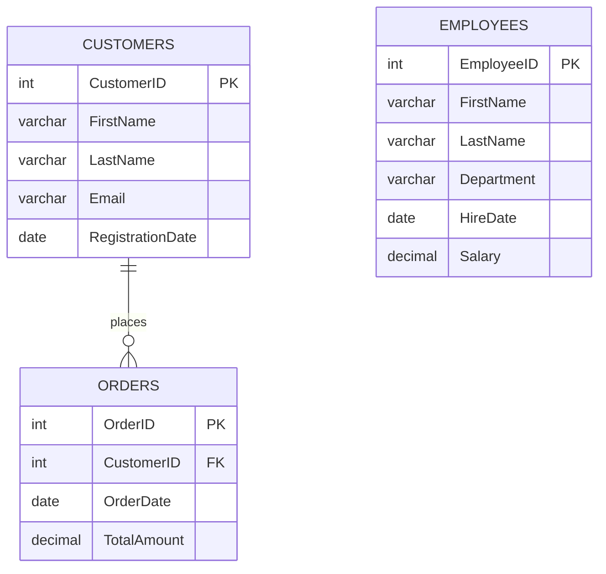

Customers place orders (one-to-many), while the `Employees` table stands alone and is used to practice subqueries, string functions, and `CASE` logic.

---

## 📸 Screenshots

### 1️⃣ Database Creation

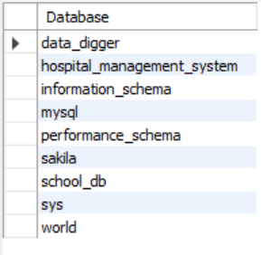
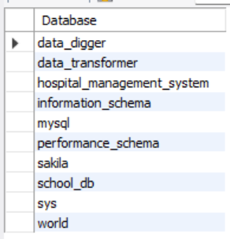

Shows the list of databases before and after `Data_Transformer` is created.

### 2️⃣ INNER JOIN — Orders with Customer Details

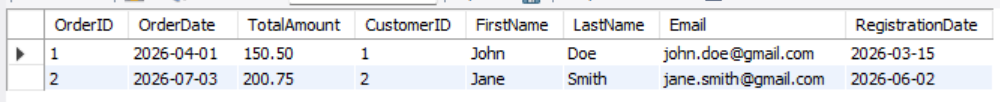

Retrieves all orders along with the matching customer details (only rows where an order exists).

### 3️⃣ LEFT JOIN — All Customers with Their Orders

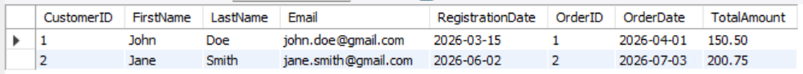

Retrieves every customer and their corresponding orders, including customers with no orders.

### 4️⃣ RIGHT JOIN — All Orders with Their Customers

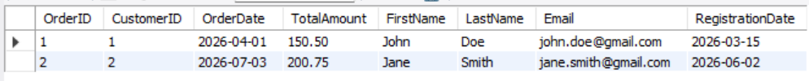

Retrieves every order and its corresponding customer.

### 5️⃣ FULL OUTER JOIN (Simulated with UNION)

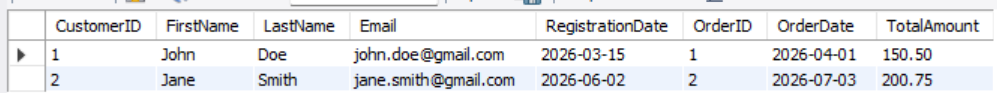

Combines `LEFT JOIN` and `RIGHT JOIN` results with `UNION` to return all customers and all orders, regardless of matching.

### 6️⃣ Customers with Above-Average Orders (Subquery)

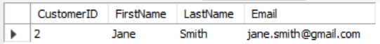

Customers who placed an order worth more than the average order amount (**Jane Smith** — 200.75 vs. average ≈ 175.63).

### 7️⃣ Employees with Above-Average Salary (Subquery)

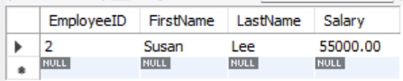

Employees earning more than the average salary (**Susan Lee** — 55,000.00 vs. average 52,500.00).

### 8️⃣ Year and Month from OrderDate

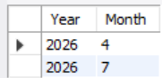

`YEAR(OrderDate)` and `MONTH(OrderDate)` used to break each order date into its components.

### 9️⃣ Date Difference from Today

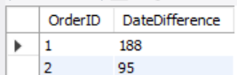

`DATEDIFF(CURDATE(), OrderDate)` — the number of days between each order and the current date.

### 🔟 Formatted Order Date (DD-MM-YYYY)

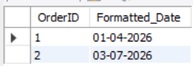

`DATE_FORMAT(OrderDate, '%d-%m-%Y')` converts dates into a more readable format.

### 1️⃣1️⃣ Full Name with CONCAT

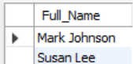
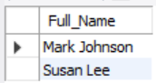

`CONCAT(FirstName, ' ', LastName)` joins first and last names into a single `Full_Name` column for employees.

### 1️⃣2️⃣ Replace Part of a String

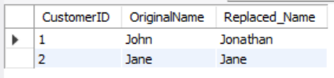

`REPLACE(FirstName, 'John', 'Jonathan')` — John becomes Jonathan, while other names stay unchanged.

### 1️⃣3️⃣ Uppercase & Lowercase — Customers

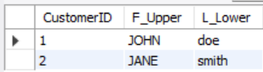

`UPPER(FirstName)` and `LOWER(LastName)` applied to the Customers table.

### 1️⃣4️⃣ Uppercase & Lowercase — Employees

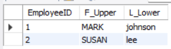

The same `UPPER` / `LOWER` transformation applied to the Employees table.

### 1️⃣5️⃣ Trim Extra Spaces from Email

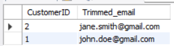

`TRIM(Email)` removes leading and trailing spaces from the email field.

### 1️⃣6️⃣ Running Total of Order Amounts

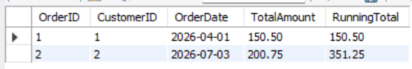

`SUM(TotalAmount) OVER (ORDER BY OrderDate, OrderID ROWS BETWEEN UNBOUNDED PRECEDING AND CURRENT ROW)` — the running total reaches **351.25**.

### 1️⃣7️⃣ Rank Orders by Total Amount

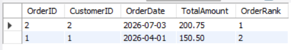

`RANK() OVER (ORDER BY TotalAmount DESC)` — Order 2 (200.75) ranks first, Order 1 (150.50) ranks second.

### 1️⃣8️⃣ Discount Pricing with CASE

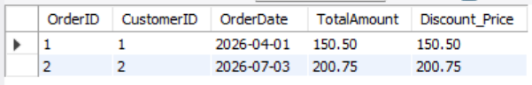

`CASE` applies 10% off above 1000 and 5% off above 500. No order qualifies with the current sample data, so prices remain unchanged.

### 1️⃣9️⃣ Salary Categories with CASE

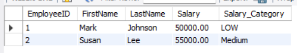

Employees labeled High (> 100,000), Medium (> 50,000), or LOW — Mark Johnson (50,000) is **LOW**, Susan Lee (55,000) is **Medium**.

---

## 📌 Key Results

| Metric | Result |
|---|---:|
| **Total Customers** | 2 |
| **Total Orders** | 2 |
| **Total Order Value** | 351.25 |
| **Average Order Amount** | ≈ 175.63 |
| **Customer with Above-Average Order** | Jane Smith (200.75) |
| **Average Employee Salary** | 52,500.00 |
| **Employee with Above-Average Salary** | Susan Lee (55,000.00) |
| **Highest-Ranked Order** | Order 2 (200.75) |
| **Final Running Total** | 351.25 |
| **Salary Categories** | Mark Johnson — LOW, Susan Lee — Medium |

---

## 📁 Project Structure

```text
Data_Transformer/
├── Data_Transformer.sql      # Full SQL script (schema + data + queries)
├── README.md                 # Project documentation
└── Screenshots/
    ├── Screenshot-1.png      # Databases before
    ├── Screenshot-2.png      # Databases after
    ├── Screenshot-3.png      # INNER JOIN
    ├── Screenshot-4.png      # LEFT JOIN
    ├── Screenshot-5.png      # RIGHT JOIN
    ├── Screenshot-6.png      # FULL OUTER JOIN (UNION)
    ├── Screenshot-7.png      # Customers above average order
    ├── Screenshot-8.png      # Employees above average salary
    ├── Screenshot-9.png      # Year and month extraction
    ├── Screenshot-10.png     # Date difference
    ├── Screenshot-11.png     # Formatted date
    ├── Screenshot-12.png     # CONCAT full name
    ├── Screenshot-13.png     # CONCAT full name (repeat)
    ├── Screenshot-14.png     # REPLACE
    ├── Screenshot-15.png     # UPPER / LOWER customers
    ├── Screenshot-16.png     # UPPER / LOWER employees
    ├── Screenshot-17.png     # TRIM email
    ├── Screenshot-18.png     # Running total
    ├── Screenshot-19.png     # RANK
    ├── Screenshot-20.png     # Discount CASE
    └── Screenshot-21.png     # Salary category CASE
```

---

## ▶️ How to Run

### 1. Clone or download the project

Place `Data_Transformer.sql` in your working directory.

### 2. Open a MySQL client

Use MySQL Workbench or any MySQL-compatible client.

### 3. Run the script

```sql
SOURCE Data_Transformer.sql;
```

This creates the `Data_Transformer` database, builds all three tables, seeds them with sample data, and runs every join, subquery, date, string, window, and `CASE` query.

> **Note:** `DATEDIFF(CURDATE(), OrderDate)` depends on the day you run the script, so the values in your output will differ from the screenshot over time.

---

## 🧭 Script Sections

```text
1. Database & Table Setup (Customers, Orders, Employees)
2. Sample Data Insertion
3. Joins — INNER / LEFT / RIGHT / simulated FULL OUTER
4. Subqueries — above-average orders and salaries
5. Date Functions — YEAR, MONTH, DATEDIFF, DATE_FORMAT
6. String Functions — CONCAT, REPLACE, UPPER, LOWER, TRIM
7. Window Functions — running total (SUM OVER) and RANK
8. CASE Expressions — order discounts and salary categories
```

---

## 📊 Dataset Information

The schema is made up of **3 tables**:

| Table | Key Columns |
|---|---|
| **Customers** | CustomerID, FirstName, LastName, Email, RegistrationDate |
| **Orders** | OrderID, CustomerID, OrderDate, TotalAmount |
| **Employees** | EmployeeID, FirstName, LastName, Department, HireDate, Salary |

`Orders.CustomerID` is a foreign key referencing `Customers.CustomerID`, and `Customers.Email` is enforced as `UNIQUE`.

---

## 💼 Why This Project Matters

This project demonstrates practical skills relevant to entry-level **SQL, Database Management, and Data Analysis** work:

- ✅ Designing a relational schema with proper constraints
- ✅ Combining data across tables with every major join type
- ✅ Writing subqueries for targeted, condition-based lookups
- ✅ Transforming dates and text with built-in MySQL functions
- ✅ Using window functions for running totals and rankings
- ✅ Applying `CASE` logic to categorize and price data

---

## 👨‍💻 Author

**Akshar Tailor**

---

⭐ If you found this project useful, consider giving it a star!
